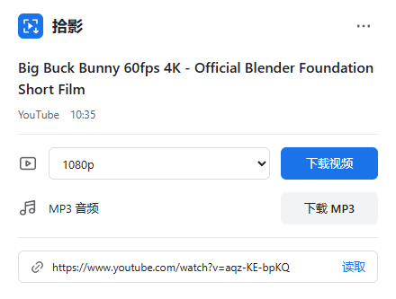

# Ruxget

原名「拾影」，0.4.45 起统一使用英文名 Ruxget。

免费、开源、无广告的中文网页视频下载插件。打开视频，点一下保存。

当前插件与桌面版均为 **0.4.50**：新增抖音、快手、小红书视频一键下载（插件弹窗，MP4 / MP3）；商店版插件不再包含 YouTube（另提供 GitHub 完整版）；新增 B站字幕、MP3 歌名/作者/封面、浮钮一键下载、最近下载列表，分 P 最多 1000 项；统一改名为 Ruxget；下载按钮旁的 ▾ 可选择用浏览器或桌面版下载并记住选择；桌面版安装与连接改为三步向导；安装器重新设计；代理默认跟随系统设置；插件、向导、进度页和安装器支持中英文。网盘、BT、续传、任务详情及主窗口 / 迷你窗保留。安装与验证范围见 [桌面版说明](desktop/README.md)。Chrome 商店更新须经过审核，以商店实际显示的版本为准。



网盘内置下载已通过隔离页面与 API 数据检查，并用公开文件完成真实下载、暂停与续传；八家网盘的登录账号尚未逐一实测。

## 下载与安装

Ruxget 有两个插件版本，功能只差 YouTube：

| 版本 | 从哪里装 | YouTube |
|---|---|---|
| 商店版 | Chrome 网上应用店 | 不支持（商店政策不允许） |
| 完整版 | [Releases](https://github.com/hesay77-cmyk/shiying/releases/latest) 的 `Ruxget-0.4.50-Chrome-full.zip` | 支持，YouTube 视频页上也有浮钮 |

桌面版（`Ruxget-0.4.50-Windows-Setup.exe`）可以直接粘贴 YouTube、B站、SoundCloud 等常见视频网站的链接下载，与插件版本无关。

完整版 ZIP 解压后在 Chrome 打开 `chrome://extensions`，开启“开发者模式”，点击“加载已解压的扩展程序”，选择包含 `manifest.json` 的目录。需要 Chrome 116 或更新版本。

点击 Chrome 工具栏的拼图图标，把 Ruxget 固定在工具栏。Chrome 商店使用现有的商品（原名「拾影 · 网页视频下载」）更新，不需要另装第二个商店条目；提交和上架状态以商店后台为准。

## 怎么用

1. 打开正常可播放的 B站、抖音、快手或小红书视频（完整版也支持 YouTube）。抖音和小红书第一次下载时，Chrome 会问一次是否允许访问它们的视频服务器。
2. 点 Ruxget，等待标题和原站实际清晰度出现。
3. 点“下载视频”保存有声音的 MP4，或点“下载 MP3”保存音频。

成品由 Chrome 保存到下载目录中的“Ruxget”文件夹。主流程在 Chrome 内下载、合并和编码，无需安装或启动下载助手。下载期间可以关闭小面板，请保持 Chrome 运行。

其他网页首次使用时，点击“允许此网站”，按本页检测到的媒体来源授权，然后在媒体列表中下载视频、音频或 HLS。可在菜单“管理网站权限”中添加具体网址或撤销授权；不同媒体来源可能需要分别确认。高级工具保留可选外部服务；仅在用户主动配置或使用时参与，详见 [隐私说明](PRIVACY.md)。

## 可选网盘下载

安装最新的插件和桌面版。打开支持的网盘页，点 Chrome 中的 Ruxget，再点「开启 Ruxget 下载」；确认该网盘的可选权限后，网盘工具栏旁会出现小按钮。勾选文件，点「Ruxget 下载」，即可加入桌面队列，使用记住的保存位置；后台入队不弹主窗口。按钮右侧的小菜单可更换保存位置、查看任务或隐藏按钮；在插件里点「显示网盘按钮」可恢复。百度首次下载可能需另点「百度授权」并在百度页面确认。

内置适配源自 LinkSwift 1.1.3，覆盖百度、阿里、移动、天翼、迅雷云盘、夸克、UC、123 的部分页面。八个适配器已通过隔离页面/API 数据检查，尚未完成八家真实登录账号的下载验收；部分分享页不支持，阿里需使用列表视图。每批最多 100 个文件，受网站登录、会员、限额、实际页面/API 和签名链接有效期影响。链接过期需回网盘重新获取；不提供第三方解析服务或加速保证。源码、修改方式与许可见 [NOTICE](NOTICE.md) 和 `third-party-source/netdisk-sources.json`。

## 视频适用范围

平台主流程优先处理非直播视频，单个媒体轨最大 768 MB；大文件可尝试较低清晰度。网站格式、登录状态、区域、访问权限和媒体地址有效期会影响可用性。只列出原站实际提供的清晰度，不将放大画质冒充原生画质。

Ruxget 不提供 DRM 解密或付费、会员、登录限制绕过。请只处理您拥有权利、取得必要许可或依法允许处理的内容，并遵守来源平台条款。免费开源不会替用户取得媒体授权。

## 桌面连接提示

选择桌面下载后，未找到本机连接时可以下载安装、修复已安装程序的连接，或继续使用 Chrome。配对被拒绝、程序退出或通信异常不会一律提示重新安装；取消保留原链接，不自动下载。商店版与本地测试版的扩展 ID 不同，首次连接失败可从「已安装，修复连接」进入「一键重新配对」。

## 隐私与反馈

插件没有开发者数据接收服务器、广告或统计 SDK。为识别和下载媒体，会处理网页网址、标题、媒体内容、请求头和认证信息。媒体与任务主要在本机或会话中处理；部分设置使用 Chrome 同步。主动使用高级外部工具时可能向所选服务发送相关数据。

- [隐私说明](PRIVACY.md)
- [反馈问题](https://github.com/hesay77-cmyk/shiying/issues)（请勿公开 Cookie、令牌或私密网址）
- [Chrome 商店填写指南](docs/chrome-web-store.md)
- [版本说明](docs/release-notes.md)

## 开源与来源

Ruxget 是 [CatCatch](https://github.com/xifangczy/cat-catch) 的独立改版，非猫抓官方产品，采用 GPL-3.0。原作者及第三方版权、许可保留在 [LICENSE](LICENSE)、[NOTICE](NOTICE.md) 和 [第三方声明](lib/third-party-libraries.md)。源码 ZIP 包含插件、构建脚本与第三方来源包。

[源码来源](docs/SOURCE-PROVENANCE.md) · [原上游说明](README.catcatch.md) · [第三方来源与校验](third-party-source/SOURCES.json)

## 从源码构建

需要 Node.js。插件运行不依赖 Node.js；它只用于构建和开发检查。

```sh
node scripts/package.cjs   # build/ 是商店版，build-full/ 是完整版
node scripts/check.cjs
node scripts/native-check.cjs
node scripts/check-access.cjs
```

浏览器检查脚本（`scripts/*-check.cjs`）需要 Playwright 和 Chromium：用 `SHIYING_PLAYWRIGHT` 指定 Playwright 模块路径、`SHIYING_CHROMIUM` 指定浏览器路径，`RUXGET_TMP` 指定临时目录（默认系统临时目录）。`shortvideo-e2e-check.cjs` 另需 `RUXGET_SV_FIXTURES` 目录，内含用 ffmpeg 生成的 `clip-720.mp4`、`clip-480.mp4` 及本机 HTTPS 证书 `key.pem`、`cert.pem`。

之后在 Chrome 中加载生成的 `build` 目录。构建复制随仓库提供的文件，不拉取远端执行代码，也不启动付费 API。

发行 ZIP 使用 Python 3 标准库，先构建再执行：

```sh
python scripts/release.py
```

输出位于 `release`，已有同版本 ZIP 会被保留，脚本会停止而不会覆盖。`third-party-source` 提供实际组件对应的来源包及校验；各供应商的构建方法由原包内的说明和配置给出。

浏览器端到端开发检查另需 Playwright、可加载扩展的独立 Chromium，以及仅用于开发成品校验的 FFmpeg；通过 `SHIYING_PLAYWRIGHT`、`SHIYING_CHROMIUM`、`SHIYING_FFMPEG` 指定现有安装路径。浏览器检查会访问测试网站并下载测试媒体，按需手动执行；它们不是普通使用或静态构建的前置步骤。

最终 ZIP 检查还使用 OpenSSL 生成独立浏览器的本地测试证书，通过 `SHIYING_OPENSSL` 指定程序路径；证书和宽松的证书检查仅用于该本地样本环境，插件运行不需要这些程序。原生网站授权确认仍需人工验证；拒绝回调用模拟方式覆盖，授权/撤销与内容脚本范围通过独立逻辑检查覆盖。

### 0.4.30 网盘分享页修复（未发布）

适配百度新分享工具栏和单文件预览的下载入口；页面切换工具栏、隐藏与恢复时保持一个有效按钮。修复百度分享请求的 URL 和表单序列化。夸克请求带上当前网盘的来源头，交接时保留网页当前下载凭据并补充可读取的 Cookie，避免完整凭据被覆盖。

后台使用作者公开的 metradar 资源实测夸克：真实勾选 bou1_4l.shx（11,156 字节）、取址、交给独立桌面引擎、下载完成和 SHX 文件头校验通过。没有使用个人账号、操作现有任务或发布。百度公开页的按钮与授权提示已实测，登录后的百度完整下载尚未验收。
